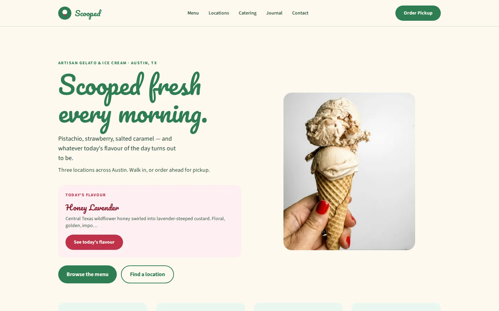
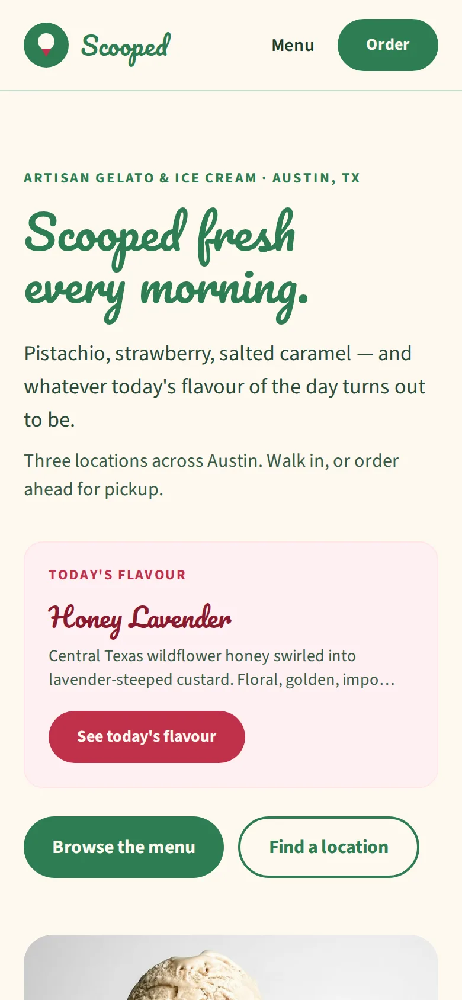
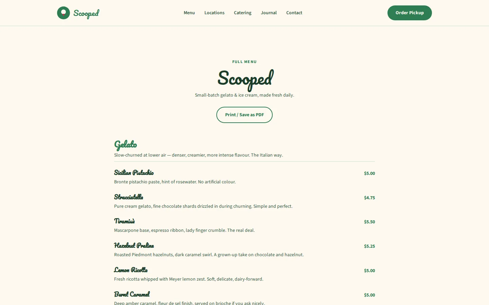
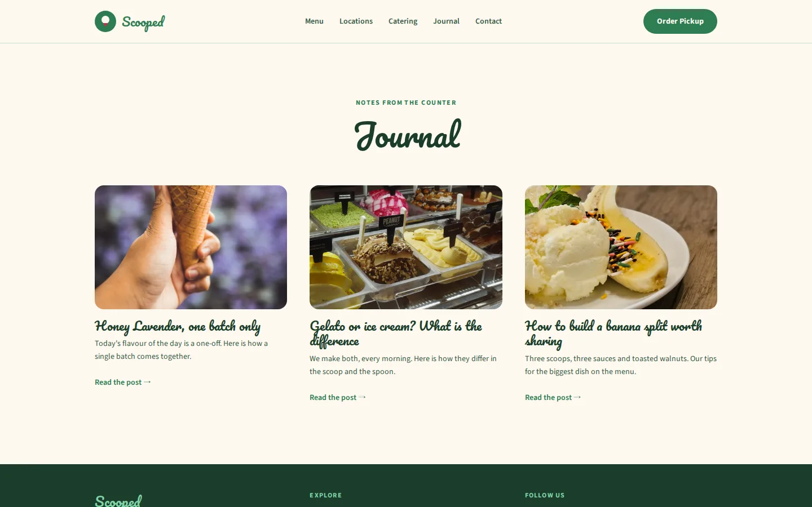

# Double Scoop: a free HTML website template for ice cream shops

<p align="center">
  <a href="https://www.allanninal.dev/templates/ice-cream-shop/"><b>View the live demo</b></a>
  &nbsp;&middot;&nbsp;
  <a href="https://checkout.freemius.com/theme/43052/plan/74944/"><b>Get the WordPress version</b></a>
</p>

<p align="center">   </p>

Double Scoop is a free, plain-HTML website for an ice cream shop. Open `index.html` and it works: no build step, no framework, no account. Edit the text in any editor and upload the folder to any web host.

## What's inside

- **Hero** — a gelato cone photo, today's flavour teaser and a four-number stat band
- **Today's flavour** — the one-batch flavour of the day and six cards for the week's rotation
- **Menu** — four tabs (Gelato, Ice Cream, Sorbet & Dairy-Free, Sundaes & Specials) with dietary tags and keyboard navigation
- **Locations** — three Austin shops with address, phone, weekly hours and a directions link
- **Order ahead** — a pickup card for each location
- **Our story** — founder story, stats and how the gelato is made
- **Gallery** — six photographs with descriptive alt text
- **Catering** — private events, with an email call to action
- **Menu page** — the whole menu on one printable page, with the allergen note
- **Journal** — three posts and their pages
- **Contact** — a plain form that opens the visitor's email app (no back end)
- **Photo credits** — footer block, removable once you swap the photos
- **Schema.org JSON-LD** — `IceCreamShop`, `Menu` and `Person`
- **Phone menu** that works without JavaScript
- Self-hosted fonts, no trackers, no analytics, no external scripts.
- Works from `file://` and from any host or sub-folder: every link is relative.

## Quick start

1. Download or clone this repository.
2. Open `index.html` in your browser. That is the whole site.
3. Edit the `.html` files in a text editor and reload.

```bash
git clone https://github.com/allanninal/double-scoop-html.git
cd double-scoop-html
open index.html        # macOS; on other systems double-click the file
```

## Customise

- **Text:** open the page (`index.html`, `menu/index.html`, `journal/index.html`, `contact/index.html`) and edit it. The business details in the demo (name, address, phone, email, hours, owner or chef) are made up; search for them and replace every one, including the `ld+json` block in `index.html`.
- **Colours and type:** the stylesheet in `assets/` starts with CSS variables (`--color-*`). Change them in one place.
- **Photos:** replace the files in `images/` with your own, keeping the names or updating the pages. Then delete the `<details data-photo-credits>` block from the footer of each page.
- **Placeholder address:** the pages carry `https://example.com/` in the canonical and social-card tags. Replace it with your domain.
- **Contact form:** it has no back end. As shipped it opens the visitor's email app. To receive messages from the page itself, point the form's `action` at a form service (Formspree, Formspark, Web3Forms, Netlify Forms) and follow that service's instructions.

## Deploy

It is a folder of static files, so any static host works.

- **GitHub Pages:** Settings, Pages, deploy from a branch, `main`, `/ (root)`.
- **Netlify or Cloudflare Pages:** drag the folder in, or connect the repository. No build command; publish directory is the repository root.
- **Any web host:** upload the folder with FTP or your host's file manager.

## Measured scores

Lighthouse mobile, this folder served as static files, median of three runs (2 November 2026):

| Page | Performance | Accessibility | Best practices | SEO |
|---|---:|---:|---:|---:|
| Home | 100 | 100 | 100 | 100 |
| Menu | 100 | 100 | 100 | 100 |
| Journal | 96 | 100 | 100 | 100 |
| Contact | 100 | 100 | 100 | 100 |

Your scores will vary with your host and photos.

## Licence

- **Code:** MIT, see [LICENSE](LICENSE).
- **Photographs:** not MIT; each is under its source's licence, see [CREDITS.md](CREDITS.md). Replace them with your own before launch.
- **Fonts:** SIL Open Font License 1.1, see [`licenses/`](licenses/).

## Want it on WordPress?

Double Scoop is also a WordPress block theme: one click imports the demo, and everything stays editable in the editor. [Get the WordPress version](https://checkout.freemius.com/theme/43052/plan/74944/). The HTML edition here stays free either way.

## Support

If this saved you time, you can [tip on Ko-fi](https://ko-fi.com/allanninal). It is optional and appreciated.
